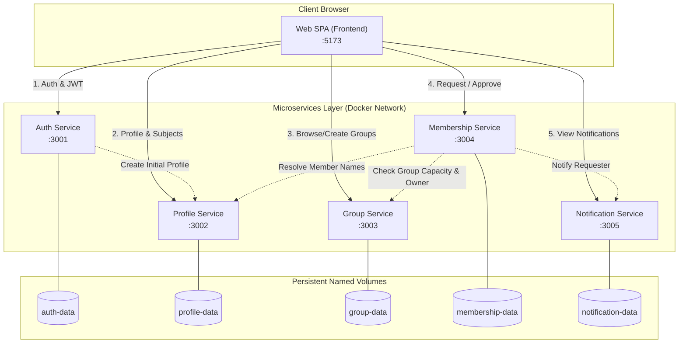

# Study Buddy — Distributed Study Group Platform
> โครงงานระบบจับกลุ่มอ่านหนังสือสำหรับนักศึกษาด้วยสถาปัตยกรรม Microservices, CI/CD Automated Pipelines และ Docker Hub Containerization

---

## 📌 สารบัญ (Table of Contents)
- [Study Buddy — Distributed Study Group Platform](#study-buddy--distributed-study-group-platform)
  - [📌 สารบัญ (Table of Contents)](#-สารบัญ-table-of-contents)
  - [📖 ภาพรวมโครงงาน (Project Overview)](#-ภาพรวมโครงงาน-project-overview)
  - [👥 สมาชิกและหน้าที่ความรับผิดชอบ (Team Members \& Roles)](#-สมาชิกและหน้าที่ความรับผิดชอบ-team-members--roles)
  - [🏗️ สถาปัตยกรรมระบบ (System Architecture)](#️-สถาปัตยกรรมระบบ-system-architecture)
  - [🔌 รายการ Services และพอร์ตที่ใช้งาน (Services \& Ports)](#-รายการ-services-และพอร์ตที่ใช้งาน-services--ports)
  - [💻 เทคโนโลยีที่ใช้ (Tech Stack)](#-เทคโนโลยีที่ใช้-tech-stack)
  - [🚀 ขั้นตอนการติดตั้งและรันระบบเพื่อตรวจงาน (Quick Start)](#-ขั้นตอนการติดตั้งและรันระบบเพื่อตรวจงาน-quick-start)
    - [1. สิ่งที่ต้องเตรียม (Prerequisites)](#1-สิ่งที่ต้องเตรียม-prerequisites)
    - [2. คำสั่งรันระบบ (One Command Start)](#2-คำสั่งรันระบบ-one-command-start)
    - [3. ตรวจสอบสถานะการทำงาน](#3-ตรวจสอบสถานะการทำงาน)
    - [4. เปิดใช้งานหน้าเว็บ](#4-เปิดใช้งานหน้าเว็บ)
    - [5. คำสั่งปิดระบบเมื่อทดสอบเสร็จสิ้น](#5-คำสั่งปิดระบบเมื่อทดสอบเสร็จสิ้น)
  - [🧪 การทดสอบระบบและคุณภาพ (Testing \& Verification)](#-การทดสอบระบบและคุณภาพ-testing--verification)
    - [1. ผลการทดสอบ Unit Tests รายบริการ (รวม 99 Automated Tests ผ่าน 100%)](#1-ผลการทดสอบ-unit-tests-รายบริการ-รวม-99-automated-tests-ผ่าน-100)
    - [2. การรัน Automated Cross-Service Integration Test (FLOW-01)](#2-การรัน-automated-cross-service-integration-test-flow-01)
  - [🔄 ระบบ CI/CD และ Container Deployment (CI/CD Pipelines)](#-ระบบ-cicd-และ-container-deployment-cicd-pipelines)
  - [🔒 ความปลอดภัยและการจัดการข้อมูล (Security \& Data Persistence)](#-ความปลอดภัยและการจัดการข้อมูล-security--data-persistence)

---

## 📖 ภาพรวมโครงงาน (Project Overview)
**Study Buddy** เป็นเว็บแอปพลิเคชันที่สร้างขึ้นมาเพื่อแก้ปัญหานักศึกษาในมหาวิทยาลัยที่ต้องการหาเพื่อนอ่านหนังสือหรือติวสอบในรายวิชาเดียวกัน โดยระบบช่วยให้นักศึกษาสามารถ:
- เข้าสู่ระบบและจัดการข้อมูลส่วนตัว (Profile & Interested Subjects)
- สร้างกลุ่มอ่านหนังสือ/ติวสอบ กำหนดวิชา หัวข้อ เวลา สถานที่ และจำนวนสมาชิกสูงสุด
- ค้นหากลุ่มตามรายวิชาที่สนใจ และคัดกรองเฉพาะกลุ่มที่ยังเปิดรับสมาชิก
- ส่งคำขอเข้าร่วมกลุ่ม (Join Request) โดยมีระบบป้องกันการสมัครซ้ำและป้องกันสมาชิกเกินจำนวน
- เจ้าของกลุ่มสามารถอนุมัติ (Approve) หรือปฏิเสธ (Reject) คำขอได้
- ระบบแจ้งเตือน (Notifications) อัตโนมัติเมื่อสถานะคำขอได้รับการอัปเดต

---

## 👥 สมาชิกและหน้าที่ความรับผิดชอบ (Team Members & Roles)

โครงงานนี้พัฒนาตามข้อกำหนด 1 สมาชิกต่อ 1 Microservice และร่วมกันพัฒนา Frontend SPA กลาง:

| ลำดับ | รหัสนักศึกษา - ชื่อ นามสกุล | บทบาทในทีม | Microservice ที่รับผิดชอบ | ขอบเขตงานหลัก |
|:---:|:---|:---|:---|:---|
| 1 | `[682110194 - สมาชิกคนที่ 1]` | **Project Manager & Lead** | `auth-service` | ระบบ Register/Login ตรวจสอบ JWT Token, จัดทำ Test Specification และ CI/CD Pipeline กลาง |
| 2 | `[682110201 - สมาชิกคนที่ 2]` | **Developer** | `profile-service` | ระบบข้อมูลโปรไฟล์ผู้ใช้ วิชาที่สนใจ (Subjects) และ API ค้นหาผู้ใช้ |
| 3 | `[682110181 - สมาชิกคนที่ 3]` | **Developer** | `group-service` | ระบบสร้าง ค้นหา กรองตามวิชา และจัดการข้อมูลกลุ่มอ่านหนังสือ |
| 4 | `[682110168 - สมาชิกคนที่ 4]` | **Developer** | `membership-service` | ระบบส่งคำขอเข้าร่วมกลุ่ม การอนุมัติ/ปฏิเสธ และควบคุมจำนวนสมาชิก |
| 5 | `[682110188 - สมาชิกคนที่ 5]` | **Tester & Developer** | `notification-service` | ระบบบันทึกและแสดงผลการแจ้งเตือน จัดทำ Automated Cross-Service Integration Tests |
| - | **สมาชิกคนที่ 2** | **Full Stack Team** | `frontend/` (SPA) | พัฒนา Web UI ด้วย Single-Page Application (Vite + TypeScript) เชื่อมต่อ API ทุกบริการ |

---

## 🏗️ สถาปัตยกรรมระบบ (System Architecture)

ระบบออกแบบตามหลักการ **Decoupled Microservices Architecture** โดยแต่ละบริการแยกอิสระทั้งโค้ด การประมวลผล และฐานข้อมูล (Database-per-service):



---

## 🔌 รายการ Services และพอร์ตที่ใช้งาน (Services & Ports)

ทุก Service มี Health Check Endpoint (`GET /health`) ตอบกลับ `{"status": "ok", "service": "..."}`:

| Service Name | Container Image (Docker Hub) | Port | Health Check URL | หน้าที่รับผิดชอบ |
|---|---|:---:|---|---|
| **Frontend** | `biwjustwork/study-buddy-frontend:v1.0.0` | `5173` | http://localhost:5173 | Web UI ส่วนกลาง (Nginx Static SPA) |
| **Auth** | `biwjustwork/study-buddy-auth:v1.0.0` | `3001` | http://localhost:3001/health | สมัครสมาชิก, ยืนยันตัวตน, ออก JWT Token |
| **Profile** | `biwjustwork/study-buddy-profile:v1.0.0` | `3002` | http://localhost:3002/health | ข้อมูลส่วนตัวและรายวิชาที่สนใจ |
| **Group** | `biwjustwork/study-buddy-group:v1.0.0` | `3003` | http://localhost:3003/health | จัดการกลุ่มอ่านหนังสือ ค้นหากลุ่มตามวิชา |
| **Membership** | `biwjustwork/study-buddy-membership:v1.0.0` | `3004` | http://localhost:3004/health | คำขอเข้าร่วม อนุมัติ/ปฏิเสธ ตรวจสอบที่นั่ง |
| **Notification** | `biwjustwork/study-buddy-notification:v1.0.0` | `3005` | http://localhost:3005/health | รายการแจ้งเตือนของผู้ใช้ |

---

## 💻 เทคโนโลยีที่ใช้ (Tech Stack)

- **Frontend**: Vite, TypeScript, Vanilla Web Standards, CSS3 Responsive Design, Nginx Alpine (Containerized)
- **Backend Services**: Node.js, Express, TypeScript / Modern ES Modules
- **Authentication**: JWT (JSON Web Tokens) มาตรฐาน HS256, Password Hashing ด้วย bcrypt (Salt Rounds = 12)
- **Data Persistence**: Isolated JSON Database Per Service พร้อม Docker Named Volumes
- **DevOps & Containers**: Docker, Multi-Stage Dockerfile, Docker Compose
- **Container Registry**: Docker Hub (`biwjustwork/*:v1.0.0`)
- **CI/CD & Automation**: GitHub Actions (Workflows สำหรับ Unit Tests, Integration Tests, Lint/Build และ Release Deployment)
- **Testing**: Node.js Native Test Runner (`node:test`), Integration Smoke Scripts

---

## 🚀 ขั้นตอนการติดตั้งและรันระบบเพื่อตรวจงาน (Quick Start)

สามารถรันระบบทั้งหมดได้ทันทีผ่าน **Docker Hub Images** ที่ทีมงาน Build และ Publish ไว้เรียบร้อยแล้ว โดยไม่จำเป็นต้องติดตั้ง Node.js หรือ Build โค้ดเอง:

### 1. สิ่งที่ต้องเตรียม (Prerequisites)
- ติดตั้งและเปิดใช้งาน **Docker Desktop** (ตรวจสอบให้สถานะเป็นสีเขียว / Engine running)

### 2. คำสั่งรันระบบ (One Command Start)
เปิด Terminal หรือ PowerShell ที่โฟลเดอร์โปรเจกต์ แล้วรันคำสั่ง:

```powershell
docker compose -f docker-compose.hub.yml up -d
```

> คำสั่งนี้จะดาวน์โหลด Image ทั้ง 6 ตัวจาก Docker Hub และเปิด Container ทั้งหมดขึ้นมาทำงานในโหมด Background ทันที

### 3. ตรวจสอบสถานะการทำงาน
```powershell
docker compose -f docker-compose.hub.yml ps
```
*ทุก Service จะต้องมีสถานะ `Up`*

### 4. เปิดใช้งานหน้าเว็บ
เข้าผ่าน Web Browser ได้ทันทีที่:
👉 **[http://localhost:5173](http://localhost:5173)**

### 5. คำสั่งปิดระบบเมื่อทดสอบเสร็จสิ้น
```powershell
docker compose -f docker-compose.hub.yml down
```
*(ข้อมูลการทดสอบ เช่น บัญชีผู้ใช้ กลุ่ม และการแจ้งเตือน จะถูกเก็บไว้อย่างปลอดภัยใน Docker Named Volumes)*

---

## 🧪 การทดสอบระบบและคุณภาพ (Testing & Verification)

โปรเจกต์นี้มีชุดทดสอบครอบคลุมทั้งระดับ Unit Tests แยกตามแต่ละ Service และ Integration/E2E Flow Tests ข้ามระบบ:

### 1. ผลการทดสอบ Unit Tests รายบริการ (รวม 99 Automated Tests ผ่าน 100%)
- **`auth-service`**: 30 tests (การสมัคร, อีเมลซ้ำ, เงื่อนไขรหัสผ่าน, JWT expiration, bcrypt hash)
- **`profile-service`**: 17 tests (การอ่าน/แก้ profile, การกรอง subjects, ป้องกันการแก้ไขข้าม user)
- **`group-service`**: 18 tests (การสร้างกลุ่ม, ตรวจสอบ validation, การค้นหาแบบ openOnly, สิทธิ์ owner)
- **`membership-service`**: 14 tests (การส่งคำขอ, ป้องกันขอซ้ำ, ป้องกันกลุ่มเต็ม, สิทธิ์การอนุมัติ)
- **`notification-service`**: 20 tests (การรับ event แจ้งเตือน, การอ่าน, การ mark read)

### 2. การรัน Automated Cross-Service Integration Test (FLOW-01)
ทดสอบ Flow การทำงานจริงข้ามทั้ง 5 Services (Register ➔ Update Profile ➔ Create Group ➔ Request Join ➔ Approve ➔ Notification):

ขณะที่ระบบ Docker กำลังรันอยู่ รันคำสั่ง:
```powershell
node tests/flow-smoke.mjs
```
**ผลลัพธ์ที่คาดหวัง**: ผ่านทุกขั้นตอน (Exit Code 0) แสดงสถานะ Pass ตั้งแต่ Authentication ไปจนถึง Notification

---

## 🔄 ระบบ CI/CD และ Container Deployment (CI/CD Pipelines)

ระบบใช้ **GitHub Actions** เป็นเครื่องมือทำ CI/CD Automation เต็มรูปแบบ ตั้งอยู่ที่ `.github/workflows/`:

1. **Service CI Workflows** (`auth-service.yml`, `profile-service.yml`, ฯลฯ):
   - ทำงานเมื่อมีการเปิด Pull Request หรือ Push โค้ดในแต่ละ Service
   - ตรวจสอบ Typecheck, Build, และรัน Unit Tests ของบริการนั้นๆ
2. **Flow Smoke CI** (`flow-smoke.yml`):
   - จำลองสภาพแวดล้อม รันทุก Service พร้อมกัน และรัน `tests/flow-smoke.mjs` ตรวจสอบ Integration แบบอัตโนมัติ
3. **Deployment Workflow** (`deploy.yml`):
   - เชื่อมต่อกับ Docker Hub ผ่าน GitHub Secrets (`DOCKERHUB_USERNAME`, `DOCKERHUB_TOKEN`)
   - Build Multi-Stage Dockerfile ของทุก Service พร้อมกัน
   - Tag เวอร์ชัน `:v1.0.0` และ `:latest` แล้ว Push ขึ้นสู่ Docker Hub Registry อัตโนมัติ:
     - `biwjustwork/study-buddy-auth`
     - `biwjustwork/study-buddy-profile`
     - `biwjustwork/study-buddy-group`
     - `biwjustwork/study-buddy-membership`
     - `biwjustwork/study-buddy-notification`
     - `biwjustwork/study-buddy-frontend`

---

## 🔒 ความปลอดภัยและการจัดการข้อมูล (Security & Data Persistence)

- **ความปลอดภัยของรหัสผ่าน**: รหัสผ่านถูกเข้ารหัสด้วย **bcrypt (12 rounds)** และไม่เคยส่งกลับไปใน Response หรือเก็บบน Log
- **การยืนยันสิทธิ์**: ใช้ **Stateless JWT Token** ฝังใน HTTP Header `Authorization: Bearer <token>` ทุก Protected Endpoints
- **Service-to-Service Security**: การสื่อสารภายในระหว่าง Microservices มีการตรวจสอบ Shared Secret Tokens
- **Data Persistence**: ข้อมูลถูกจัดเก็บแยกแต่ละ Service ใน Persistent Docker Volumes (`auth-data`, `group-data`, ฯลฯ) ข้อมูลไม่สูญหายเมื่อ Restart Container
- **Credential Safety**: ไม่มี Hardcoded Secret ในโค้ดหรือ Docker Image มีการใช้ `.env.example` เป็นแม่แบบ และส่งค่าผ่าน Environment Variables / Secrets เท่านั้น

---
*เอกสารนี้จัดทำขึ้นสำหรับการประเมินโครงงาน Study Buddy ตามเกณฑ์ข้อกำหนดโครงงานกลุ่ม*
